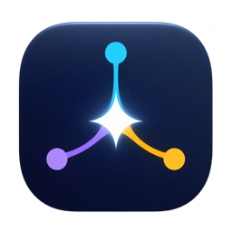

<p align="center">
  
</p>

<h1 align="center">Conductor</h1>

<p align="center">
  <strong>Multi-Model Orchestration Hub for Antigravity</strong><br/>
  Autonomously routes coding, UI aesthetics, image generation, deep diagnosis, and independent Verdict reviews across DSH, Codex (Sol / Astra), and Antigravity's built-in models.
</p>

---

## What It Includes

- **Autonomous 5-Model Routing (`rules/AGENTS.md` + `skills/orchestrate-review/SKILL.md`)**
  - **L0 · Direct Control (Antigravity Gemini 4 Neon)**: Planning, repo mapping, small edits (`<30` lines), deterministic testing, sequential merging.
  - **L1A · High-Throughput Coding Pool (`dsh_run`)**: Pooled DeepSeek Harness ACP runtime (default 3 concurrent workers) with session affinity and real-time path scope enforcement.
  - **L1B · First-Pass Aesthetic Frontend & Heavy Refactors (Built-in Claude Opus 5.5)**: Asks in one line whether to switch to Opus 5.5 (preferred for visual taste) or let Gemini 4 Neon handle it when Opus quota is tight.
  - **Codex Daily Workhorse (`codex_run` / `codex_review`, `gpt-6.2-sol`)**: Routine PR / `verdictMode` cross-reviews, cross-file debugging, fallback coding, and **ChatGPT built-in `image_gen` (priority raster image generation/editing)** with local `images: [...]` input support.
  - **L2 · Throttled Heavy Specialist (`gpt-6.2-astra`)**: Reserved for frontier math/science, unresolved deadlocks, and 2-failure cascading escalations.
- **Production Engineering Safeguards (`v1.3.0`)**
  - **Event-Driven Zero-Token Wakeup (`server/wait-job.mjs`)**: Watches persisted async jobs via `fs.watch` + MCP PID liveness guard so Antigravity wakes up immediately when background jobs finish—no polling timers.
  - **Path Ownership Guardrails & `diffStat`**: `allowedPaths` / `forbiddenPaths` (protects `.env*` and `.git/` by default) audited via git snapshots and enforced in DSH ACP permissions.
  - **Strict Heterogeneous Verification (`verdictMode: true`)**: Forces fresh read-only context (forbids reusing `threadId` / `sessionId`) with structured `ACCEPTED` / `REJECTED` JSON evidence.
  - **Git Worktree Isolation + Conflict Pre-Check**: `worktree_create`, `worktree_list` (with `potentialConflicts` file overlap detection), and `worktree_cleanup`.
  - **Large Output Spillover**: Responses exceeding `16,000` chars spill verbatim to disk (`outputFile`) with a lean head+tail preview to protect orchestrator context and quota.
  - **Cross-Window Telemetry & Report-Before-Fallback Quota Handling**: Persists daily per-model call/token stats and active cooldowns (`metrics.json`), notifies the user on any worker error, and never silently switches backends on quota exhaustion.

---

## Prerequisites

- **Required**:
  - [Antigravity](https://antigravity.google)
  - **Node.js ≥ 18**
  - **Git**
- **Optional Backends (install either or both; missing backends degrade gracefully)**:
  - **Codex CLI** (`codex`, signed in with ChatGPT account) — enables `gpt-6.2-sol`, `gpt-6.2-astra`, `codex_review`, and ChatGPT built-in `image_gen`.
  - **DeepSeek Harness** (`dsh`) — enables the 3-worker pooled ACP coding engine (`dsh_run`).

---

## Quick Install (macOS / Linux / Windows)

```bash
git clone <your-repo-url> antigravity-conductor
cd antigravity-conductor
node install.mjs
```

The installer automatically:
1. Copies the plugin bundle (`plugin.json`, `assets/logo.png`, `rules/`, `skills/`, `server/`) into `~/.gemini/config/plugins/codex-dsh-orchestrator`.
2. Installs `@openai/codex-sdk` in `server/` via `npm ci --omit=dev`.
3. Auto-detects `node`, `codex`, and `dsh` on your machine and safely merges the `codex-dsh-orchestrator` MCP server entry into `~/.gemini/config/mcp_config.json` (preserving all existing MCP servers).

> **Why global `mcp_config.json`?** Registering the MCP server in `~/.gemini/config/mcp_config.json` avoids an Antigravity plugin-bundled MCP loader issue where some tool schemas could drop parameters, ensuring all 11 tools load reliably.

After installation, restart Antigravity (or reload MCP servers) and ask:

> "Check orchestrator status" / "检查编排器状态"

### Installer Options

```bash
node install.mjs --dry-run                       # Preview without writing files
node install.mjs --dsh-concurrency 4             # Customize DSH ACP worker pool size (1–6)
node install.mjs --codex-bin /custom/path/codex  # Explicit Codex CLI path
node install.mjs --dsh-bin /custom/path/dsh      # Explicit DSH CLI path
node install.mjs --uninstall                     # Clean uninstall (keeps other MCP servers)
node install.mjs --uninstall --purge-data        # Uninstall and remove saved jobs/metrics
```

---

## MCP Tools (11 Total)

| Category | Tools |
| :--- | :--- |
| **Diagnostics** | `orchestrator_status` |
| **Codex** | `codex_run` (supports `verdictMode`, `images`, `allowedPaths`, `async`), `codex_review` |
| **DeepSeek Harness** | `dsh_run` (pooled ACP, `verdictMode`, `allowedPaths`, `async`), `dsh_close` |
| **Git Worktrees** | `worktree_create`, `worktree_list` (with `potentialConflicts`), `worktree_cleanup` |
| **Async Jobs** | `job_status`, `job_cancel`, `job_list` (+ `server/wait-job.mjs` reactive waiter) |

---

## Development & Tests

```bash
cd server
npm install
npm test
```

## License

MIT
